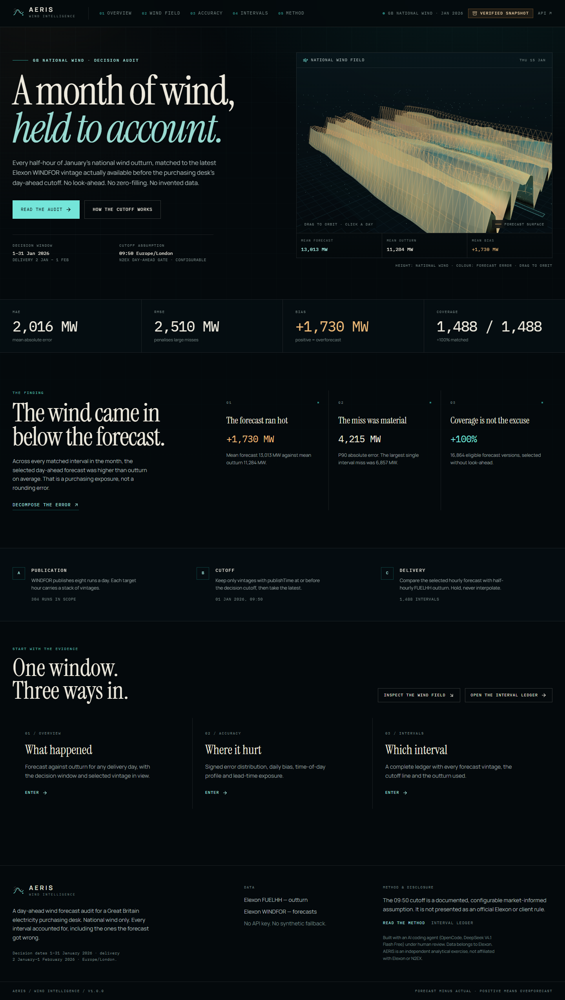
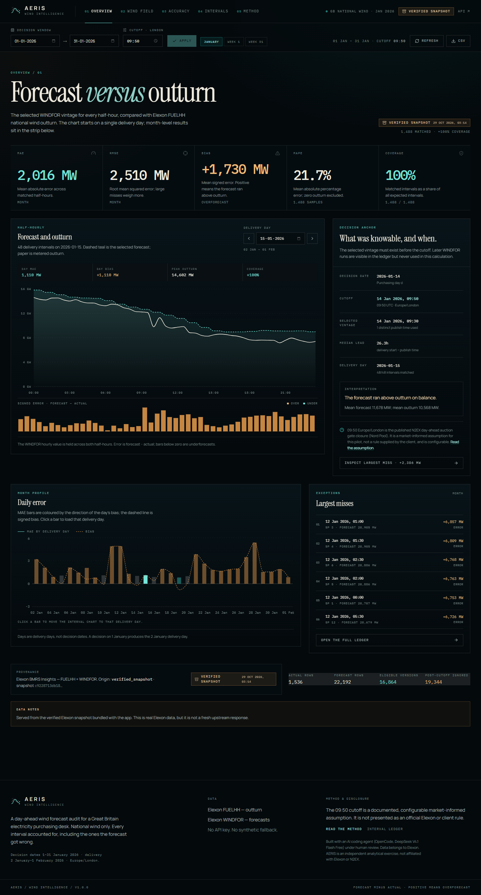
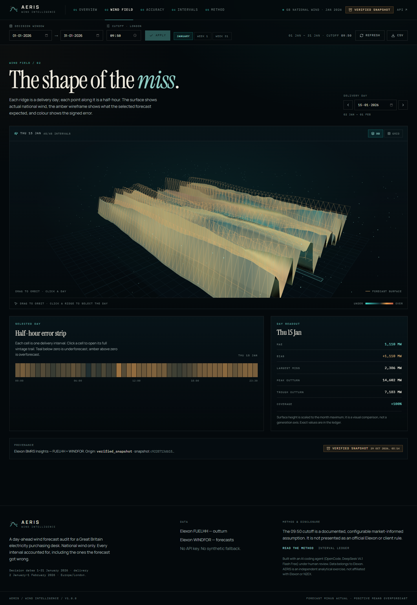
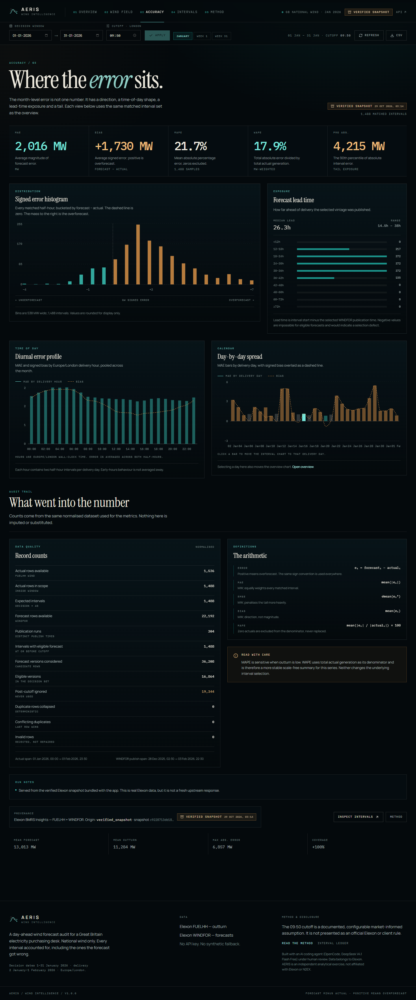
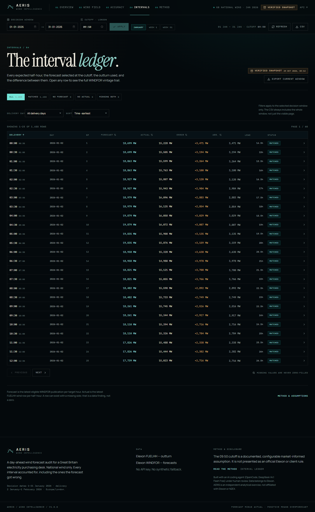
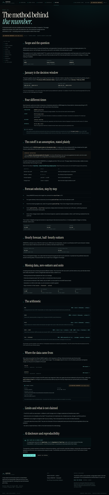
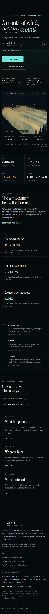

# AERIS — Wind Intelligence

**A decision-time audit of Great Britain's national wind forecasts.**

AERIS compares every half-hour of January 2026 national wind outturn with the latest Elexon
WINDFOR forecast that a day-ahead purchasing desk could actually have seen before its 09:50
Europe/London decision cutoff. It reports the error honestly: direction, size, timing, lead
time, and the exact forecast vintage behind every number.

Built for the full-stack engineering take-home: React + TypeScript frontend, Python FastAPI
backend, Docker, tests, and a reproducible Elexon snapshot.



> **Deployment status.** This application is fully containerised and was verified locally in
> production mode, but it is **not currently deployed to a public URL**. No hosting account,
> CLI session, or repository credentials were available in the build environment. The Docker
> and Heroku configuration needed to deploy is included and documented below. No deployment
> is claimed that did not happen.

---

## Headline result

January 2026 decision window, default 09:50 cutoff, **1,488 matched half-hour intervals
(100% coverage)**:

| Metric | Result | Reading |
|---|---:|---|
| MAE | **2,016.313 MW** | Average absolute forecast miss |
| RMSE | **2,510.245 MW** | Large misses are weighted heavily |
| Bias | **+1,729.931 MW** | Forecast > outturn: **overforecast** |
| MAPE | **21.678%** | Mean absolute error vs actual, zero actuals excluded |
| WAPE | **17.869%** | Total absolute error ÷ total actual generation |
| Mean forecast | **13,013.489 MW** | Selected vintage at cutoff |
| Mean actual | **11,283.558 MW** | FUELHH national wind outturn |
| P90 absolute error | **4,215 MW** | Tail exposure |
| Largest absolute miss | **6,857 MW** | 2026-01-12 01:00 UTC |

The forecast did not merely scatter around outturn. It ran **high by 1.73 GW on average**,
and the error was persistent enough to matter commercially: one in ten intervals missed by
more than 4.2 GW.

Every figure above is computed from real Elexon data by the running backend, not typed into
the UI. The interval set and coverage are asserted in the test suite, and the full set of
figures is reproducible from the bundled snapshot.

---

## What the application does

Six connected views, one shared analysis window:

| Route | Purpose |
|---|---|
| `/` | Orientation: the result, the decision chain, and routes into the evidence |
| `/overview` | Forecast vs outturn for a chosen delivery day, plus month-level KPIs, daily error, largest misses, and data provenance |
| `/windfield` | A 3D ridge field of the month's forecast surface against outturn, with a keyboard-accessible grid fallback |
| `/accuracy` | Error distribution, diurnal profile, lead-time exposure, daily spread, audit counts, and metric definitions |
| `/intervals` | A filterable, sortable, paginated ledger of all 1,488 intervals, with CSV export |
| `/method` | The full methodology: scope, cutoff, selection, resolution bridge, arithmetic, provenance, limits, and AI disclosure |

A **global interval inspector** opens from the ledger or any chart point and shows the complete
WINDFOR vintage trail for that target hour — every publication, its lead time, whether it was
available at the cutoff, and which version was selected. This is the evidence layer behind the
aggregate metrics.

### Screenshots

| Forecast vs outturn | The wind field |
|---|---|
|  |  |

| Accuracy | Interval ledger |
|---|---|
|  |  |

| Methodology | Mobile |
|---|---|
|  |  |

The design is deliberately domain-specific: an instrument panel for a trading desk, not a
generic dashboard. It uses a dark grid, editorial serif display type, monospaced operational
labels, and wind-field geometry. Motion is restrained and purposeful (GSAP reveals, a Three.js
ridge surface); `prefers-reduced-motion` disables non-essential motion, and a **GRID** toggle
provides a complete non-WebGL fallback.

---

## Methodology

### 1. January is the decision window

The brief asks for January 2026 purchasing-decision data. A day-ahead decision made on day
**D** concerns delivery on **D+1**. AERIS therefore treats **1–31 January 2026 as decision
dates**, mapping each to the following delivery day:

- decision dates: **2026-01-01 → 2026-01-31**
- delivery dates: **2026-01-02 → 2026-02-01**

This interpretation is stated in the API, the UI, and the methodology page. It is an explicit
assumption, not a hidden transformation.

### 2. The cutoff is a documented assumption, not an official rule

For each delivery interval, AERIS keeps only WINDFOR rows with:

```text
publishTime <= cutoff
```

where the cutoff is **09:50 Europe/London on the decision date**. This aligns with the
published N2EX day-ahead auction gate closure (Nord Pool). It is a **market-informed assumption
for this pilot**, not a cutoff supplied by the client or mandated by Elexon, and it is
configurable in the UI and API (any `HH:MM` from 00:00 to 23:59).

The application distinguishes four times explicitly:

| Time | Meaning |
|---|---|
| **Publication** | `WINDFOR.publishTime` — when Elexon published that forecast version |
| **Cutoff** | 09:50 Europe/London on the decision date — what the desk could know |
| **Delivery** | The half-hour `startTime` being forecast |
| **Retrieval** | When AERIS fetched the data (shown in provenance) |

Data is stored and compared in UTC; civil decision windows and display use Europe/London.

### 3. Forecast selection, step by step

1. Normalise both datasets, parsing timestamps as UTC and preserving API row order.
2. Group WINDFOR rows by their target hour (`startTime`).
3. For each delivery interval, take the WINDFOR hour bucket containing it.
4. Discard every version published after that interval's decision cutoff.
5. Select the remaining version with the **greatest `publishTime`**.
6. Ties on `publishTime` resolve deterministically to the last row in API order. Exact
   `(publishTime, startTime)` duplicates are collapsed during normalisation; conflicts are
   counted and surfaced in data quality.
7. Every other version remains visible in the inspector, marked eligible or excluded.
8. Actuals use the latest FUELHH revision for each settlement period.

This is a **decision-time** selection, not a "latest available now" selection. Later vintages
never leak into the score.

### 4. Hourly forecast, half-hourly outturn

WINDFOR is natively hourly; FUELHH is half-hourly. Each hourly forecast value is held across
**both** half-hour delivery intervals inside that hour:

```text
WINDFOR 10:00 value  →  10:00–10:30 and 10:30–11:00
```

No interpolation, smoothing, or synthetic half-hour values are created. The bridge is
documented in the API payload and the UI. The inspector flags intervals that use the held
hourly value.

### 5. Missing data is never zero

A missing forecast and a missing actual are different states. Nothing is zero-filled.

- Intervals are included in metrics **only when both** a selected forecast and an actual exist.
- Missing counts are exposed separately (`missing_forecast`, `missing_actual`, `missing_both`).
- MAPE excludes zero actuals from the denominator rather than substituting a value.
- Duplicate and invalid upstream rows are counted, not silently swallowed.

### 6. The arithmetic

```text
error_i        = forecast_i − actual_i          (positive = overforecast)
bias           = mean(error_i)
MAE            = mean(|error_i|)
RMSE           = sqrt(mean(error_i²))
MAPE           = mean(|error_i| / |actual_i|) × 100   (actual_i ≠ 0)
WAPE           = Σ|error_i| / Σ|actual_i| × 100
absolute error = |forecast_i − actual_i|
```

MAE, RMSE, and bias use the same matched interval set. Percentiles use absolute error. The
sign convention is consistent everywhere: **forecast minus actual; positive means
overforecast**.

---

## Data and provenance

### Sources

| Dataset | Role | Fields used | Elexon endpoint |
|---|---|---|---|
| **FUELHH** | Actual national wind outturn, half-hourly | `startTime`, `generation`, `fuelType=WIND` | `/datasets/FUELHH` |
| **WINDFOR** | National wind forecast vintages, hourly | `startTime`, `publishTime`, `generation` | `/datasets/WINDFOR` |

No API key is required. AERIS queries the historical dataset endpoints with explicit
`settlementDateFrom/To` and `publishDateTimeFrom/To` ranges, in **≤7-day chunks** as required
by the API. The `/stream` endpoints are deliberately not used because they ignore ranges and
return only the latest publication.

One subtle failure was found and fixed during the build: a date-only `publishDateTimeTo`
silently resolves to midnight, dropping the final day of each request (every Saturday).
The snapshot was rebuilt with an explicit `T23:59:59Z` end time. This is documented because it
materially affects data completeness.

### Bundled verified snapshot

Elexon data changes and public APIs fail. The repo includes a real, verified snapshot used as
a labelled fallback when live retrieval is unavailable:

- file: `backend/data/elexon-jan-2026.json.gz`
- size: 142,441 bytes
- content SHA-256 (canonical payload, metadata excluded):
  `c9228713db18c042fd675d81c76aefe4602a185dc336da5e86b7a412a4bc1288`
- contents: **22,192** WINDFOR rows, **1,536** FUELHH actual rows, **384** publication runs
- coverage: actuals 2026-01-01 00:00 → 2026-02-01 23:30 UTC; forecasts 2025-12-28 02:30 →
  2026-02-03 22:30 UTC

This is **real Elexon data, not synthetic data**. The UI and API expose whether a response came
from live Elexon, a live cache, or the verified snapshot, including retrieval time and checksum.
If the upstream API fails and no fallback is allowed, the API returns a clear `503`; it does not
invent values.

Rebuild the snapshot with:

```bash
python -m backend.scripts.build_snapshot
```

---

## Architecture

```text
React 18 + TypeScript + Vite
  ├─ React Router routes
  ├─ Recharts for analytical charts
  ├─ GSAP for purposeful reveals
  ├─ Three.js for the wind-field surface (lazy-loaded, with grid fallback)
  └─ Tailwind + custom CSS design system
                │  /api (JSON, CSV)
                ▼
FastAPI (Python 3.13)
  ├─ config.py        environment settings, CORS, paths
  ├─ elexon.py        historical client, 7-day chunking, retries, cache, snapshot fallback
  ├─ normalization.py deterministic parsing, duplicate handling, quality counts
  ├─ selection.py     cutoff filter, latest-vintage selection, vintage trail
  ├─ analysis.py      interval grid, decision windows, serializers, CSV
  ├─ metrics.py       MAE, RMSE, bias, MAPE/WAPE, daily/diurnal/lead-time aggregates
  └─ main.py          routes, error handling, GZip, SPA serving
                │
                ▼
Verified Elexon snapshot (fallback) + live BMRS API
```

The production image builds the frontend, copies the static bundle into the Python image, and
serves both the SPA and the API from one FastAPI process. There is no frontend/backend URL
configuration to get wrong in production.

### Repository map

```text
.
├─ backend/
│  ├─ app/                  FastAPI application and analysis engine
│  ├─ data/                 verified January 2026 Elexon snapshot
│  ├─ scripts/              reproducible snapshot builder
│  └─ tests/                40 backend tests
├─ frontend/
│  ├─ src/components/       landing, overview, wind field, accuracy, intervals, method
│  ├─ src/context/          shared filters, data fetching, interval selection
│  ├─ src/lib/              shared calculations, formatting, colours (+ unit tests)
│  └─ src/styles.css        design system, responsive rules, motion fallbacks
├─ docs/                    README screenshots
├─ Dockerfile               multi-stage production build
├─ docker-compose.yml       one-command local container
├─ heroku.yml               Heroku container deployment
├─ .github/workflows/ci.yml backend tests, frontend checks, Docker build
├─ .env.example             all runtime settings, no secrets
└─ DEMO.md                  10-minute demo script
```

---

## Run locally

Requirements: Python 3.13+, Node.js 20+ (22 recommended), npm.

### Backend

From the repository root:

```powershell
python -m venv .venv
.\.venv\Scripts\Activate.ps1
pip install -r backend/requirements-dev.txt
uvicorn backend.app.main:app --reload --port 8000
```

macOS/Linux activation is `source .venv/bin/activate`. The API is at
`http://127.0.0.1:8000`, interactive docs at `http://127.0.0.1:8000/api/docs`.

### Frontend

In a second terminal:

```bash
cd frontend
npm ci
npm run dev
```

Open `http://localhost:5173`. Vite proxies `/api` to `http://127.0.0.1:8000`.

### Offline / deterministic mode

```bash
AERIS_DATA_MODE=snapshot uvicorn backend.app.main:app --port 8000
```

In PowerShell:

```powershell
$env:AERIS_DATA_MODE = "snapshot"
uvicorn backend.app.main:app --port 8000
```

Snapshot mode never calls Elexon and produces the headline results above.

### Environment variables

All settings use the `AERIS_` prefix. See `.env.example`. There are **no secrets**.

| Variable | Default | Purpose |
|---|---|---|
| `AERIS_DATA_MODE` | `live` | `live` calls Elexon and may fall back; `snapshot` is offline |
| `AERIS_ALLOW_SNAPSHOT_FALLBACK` | `true` | Use the verified snapshot if Elexon fails |
| `AERIS_CACHE_TTL_SECONDS` | `21600` | Disk/memory cache lifetime (6 hours) |
| `AERIS_CORS_ORIGINS` | localhost origins | Comma-separated allowed browser origins |
| `AERIS_STATIC_DIR` | `static` | Built SPA directory |
| `AERIS_CACHE_DIR` | `backend/.cache` | Upstream cache directory |
| `AERIS_LOG_LEVEL` | `INFO` | Log verbosity |

---

## Docker

Build and run the production image:

```bash
docker compose up --build
```

Open `http://localhost:8000`. Or manually:

```bash
docker build -t aeris-wind-intelligence .
docker run --rm -p 8000:8000 \
  -e AERIS_DATA_MODE=snapshot \
  aeris-wind-intelligence
```

**Verified in this build:** the image built successfully and the running container served
`/api/health`, `/api/overview` (1,488 intervals, MAE 2,016.313 MW), and the SPA route
`/overview` with HTTP 200. The container runs as a non-root `aeris` user, honours `PORT`,
includes a healthcheck, and serves the compiled frontend from FastAPI.

---

## Deployment

### Status

**Not deployed.** The build environment had no Heroku, Vercel, or GitHub CLI, and no account
credentials were available. A deployed URL and public repository cannot be truthfully claimed.
Everything needed to deploy is committed and tested.

### Heroku (container stack)

The brief accepts Heroku. `heroku.yml` uses the existing Dockerfile:

```bash
heroku login
heroku create <your-app-name>
heroku stack:set container --app <your-app-name>
heroku config:set AERIS_CORS_ORIGINS=https://<your-app-name>.herokuapp.com --app <your-app-name>
git push heroku main
```

Then set the repository's deployed URL to `https://<your-app-name>.herokuapp.com`. The image
already runs Uvicorn on `$PORT` with proxy headers, so no additional buildpack is required.

### Other container hosts

The same image runs on Render, Railway, Fly.io, or any Docker host. Expose the injected `PORT`,
set `AERIS_CORS_ORIGINS` to the public origin, and keep `AERIS_ALLOW_SNAPSHOT_FALLBACK=true`
so a transient Elexon outage degrades to the labelled snapshot instead of an empty screen.

### Vercel note

Vercel is a good fit for the static frontend but not for this long-lived FastAPI service
without a separate backend deployment. No untested Vercel configuration is included. The
single-container Heroku path is the supported deployment route.

---

## Demo

`DEMO.md` contains a two-part, 9:30 recording script with exact timings, click paths, narration,
and fallback plan. **No video has been uploaded yet**; after recording, the unlisted YouTube URL
should be added here and to the submission form.

Planned structure:

- **Part I (0:00–3:45):** the measurement problem, decision-time cutoff, vintage selection, and
  the hourly-to-half-hourly bridge.
- **Part II (3:45–9:30):** overview, 3D wind field and grid fallback, accuracy evidence, interval
  ledger and inspector, CSV export, limits, and close.

---

## API

Base path: `/api`. All analytics endpoints accept `start_date`, `end_date` (decision dates,
`YYYY-MM-DD`), and `cutoff_time` (`HH:MM`, default `09:50`).

| Endpoint | Returns |
|---|---|
| `GET /api/health` | Liveness, data mode, snapshot/static availability |
| `GET /api/meta` | Window, cutoff, sources, endpoint catalogue, interpretation |
| `GET /api/overview` | Metrics, 1,488-point series, daily/diurnal/histogram/top-error/lead-time aggregates, provenance |
| `GET /api/accuracy` | Same aggregates without the interval series |
| `GET /api/forecasts` | Series plus selected publication runs |
| `GET /api/intervals` | Paginated ledger; filters `status`, `delivery_date`; `sort_by`, `sort_dir`, `page`, `page_size` |
| `GET /api/intervals/detail` | One interval with full vintage trail (`start_time` required) |
| `GET /api/vintages` | Vintage-only view for one interval |
| `GET /api/export.csv` | Full CSV of the selected window, including missing rows and flags |

Interactive OpenAPI documentation: `/api/docs`.

Example:

```bash
curl "http://localhost:8000/api/overview?start_date=2026-01-01&end_date=2026-01-31&cutoff_time=09:50"
```

---

## Tests and verification

### Backend — 40 tests

```bash
python -m pytest backend/tests
```

Coverage includes:

- MAE, RMSE, bias, MAPE/WAPE, percentile and histogram formulas
- selection boundaries: exactly at cutoff, one second after, latest eligible vintage
- duplicates, conflicting duplicates, and deterministic tie-breaking
- missing forecasts, missing actuals, zero actuals, empty datasets
- timezone conversion and DST-safe interval generation
- 7-day chunking, API failures, retries, snapshot fallback, no synthetic substitution
- API validation, pagination, sorting, CSV output, and SPA routing

### Frontend — 15 tests

```bash
cd frontend
npm run typecheck
npm run lint
npm test
npm run build
```

Unit tests cover shared analytical calculations and formatters. The production build is also
run inside the Docker image, so a type or bundling failure blocks deployment.

### Manual and accessibility QA

Verified at 1440 px desktop and 390 px mobile across all six routes:

- no horizontal overflow and no console errors
- all scroll reveals resolve; reduced-motion path verified
- 3D scene renders; GRID fallback works without WebGL
- mobile navigation and inspector drawer work
- keyboard focus, labelled controls, and the vintage trail are accessible
- Axe scan: **zero WCAG A/AA violations** on all six routes and the open inspector
- CSV export returns 1,488 rows; date presets and cutoff changes recompute correctly

---

## Assumptions and limits

1. **Decision-date interpretation.** January 2026 is the decision period; delivery is the
   following day. This is documented, not implicit.
2. **Cutoff assumption.** 09:50 Europe/London is a configurable market-informed proxy based on
   N2EX gate closure, not a client rule. Results will change with the cutoff; the UI exposes
   this rather than hiding it.
3. **National only.** This audits national GB wind, not regional generation, interconnector
   flows, or individual wind farms.
4. **Hourly-to-half-hourly bridge.** The hourly WINDFOR value is held across both half-hours.
   This is a transparent approximation and may slightly smooth within-hour variation.
5. **No commercial model.** No imbalance prices, hedging, bid optimisation, or procurement
   recommendation is produced. The output is forecast accuracy evidence.
6. **Coverage is not a universal guarantee.** January 2026 happens to have complete matched
   coverage in the snapshot. Sparse periods would show explicit missing counts, not zeroes.
7. **Not an official Elexon or N2EX product.** AERIS is an independent analytical exercise and
   is not affiliated with or endorsed by either organisation.

---

## AI tool disclosure

This submission was built with an **AI coding agent: OpenCode, using the DeepSeek V4.1 Flash
Free model**, under human direction and review. The agent wrote application code, tests, data
tooling, and documentation; the human operator set the requirements, reviewed methodological
choices, ran the application, and approved the result. No other AI tools were used.

All displayed data is real Elexon data. No synthetic or fabricated values are used to fill gaps,
and no deployment, test result, or video is claimed unless it actually occurred.

---

## Attribution

- Forecast and outturn data: **Elexon BMRS** (`WINDFOR`, `FUELHH`), publicly available.
- Gate-closure reference: **Nord Pool / N2EX** day-ahead auction documentation.
- Fonts: Instrument Serif, Manrope, IBM Plex Mono (via Fontsource).
- Charts: Recharts. 3D: Three.js. Motion: GSAP.

Data belongs to Elexon. AERIS is an independent analytical exercise.
